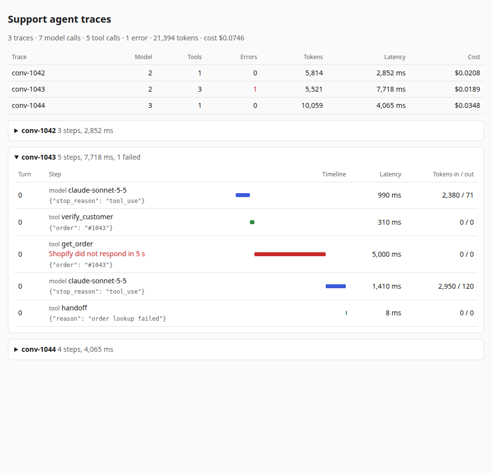

# agent-trace-viewer

See what your AI agent actually did. `atv` reads agent traces from JSONL (one line per model
call or tool call) and prints a per-run summary or writes a self-contained HTML report: a
waterfall of every step, its latency, tokens, cost, and errors.



No dependencies, no server, no JavaScript in the report. Attach it to a pull request or keep it
as a CI artifact next to your eval results.

## Install

```bash
uv tool install git+https://github.com/thealirazadev/agent-trace-viewer
```

## Use

```bash
$ atv --price claude-sonnet-5-5=3,15 summary examples/support-agent.jsonl
trace      model  tools  errors  tokens in  tokens out   latency     cost
conv-1042      2      1       0      5,530         284  2,852 ms  $0.0208
conv-1043      2      3       1      5,330         191  7,718 ms  $0.0189
conv-1044      3      1       0      9,670         389  4,065 ms  $0.0348

$ atv render examples/support-agent.jsonl -o report.html --title "Support agent traces"
wrote report.html (3 traces)
```

`--price MODEL=IN,OUT` takes USD per million input and output tokens and can be repeated per
model. Prices are never built in, because they change; without them the report shows tokens only.
If a trace uses a model you did not price, its cost shows as `-` rather than a wrong total.

Traces with a failed step open expanded in the report, so failures are the first thing you see.

## Trace format

One JSON object per line:

```json
{"trace_id": "conv-1043", "turn": 0, "kind": "tool", "name": "get_order", "latency_ms": 5000,
 "error": "Shopify did not respond in 5 s", "detail": {"order": "#1043"}}
```

| Field | Required | Meaning |
| --- | --- | --- |
| `trace_id` | yes | Groups steps into one run (a conversation turn, an eval case) |
| `kind` | yes | `model` or `tool` |
| `name` | yes | Model id or tool name |
| `latency_ms` | yes | Wall time of the step |
| `turn` | no | Turn inside the trace (default 0) |
| `input_tokens`, `output_tokens` | no | Provider-reported usage (default 0) |
| `error` | no | Set when the step failed |
| `detail` | no | Any object: tool input, stop reason |

A malformed line stops the run with `file:line: reason`. A viewer that skipped bad lines would
hide the failures it exists to show.

### From Shopwright

[Shopwright](https://github.com/thealirazadev/shopwright) stores traces in Postgres with the same
fields, so exporting a store's recent conversations is one query:

```bash
psql "$DATABASE_URL" -At -c "
  SELECT json_build_object('trace_id', conversation_id, 'turn', turn, 'kind', kind,
    'name', name, 'latency_ms', latency_ms, 'input_tokens', input_tokens,
    'output_tokens', output_tokens, 'detail', detail,
    'error', NULLIF(NULLIF(detail->>'error', 'false'), ''))
  FROM traces WHERE created_at > now() - interval '1 day' ORDER BY id" > traces.jsonl
atv render traces.jsonl -o report.html
```

### From your own agent

Append one line per step from your agent loop:

```python
import json, time


def record(path, trace_id, kind, name, started, **fields):
    step = {
        "trace_id": trace_id,
        "kind": kind,
        "name": name,
        "latency_ms": round((time.monotonic() - started) * 1000),
        **fields,
    }
    with open(path, "a") as f:
        f.write(json.dumps(step) + "\n")
```

## Development

```bash
uv sync
uv run ruff check . && uv run ruff format --check . && uv run mypy && uv run pytest
```

Design notes are in [docs/decisions.md](docs/decisions.md).

## License

MIT
